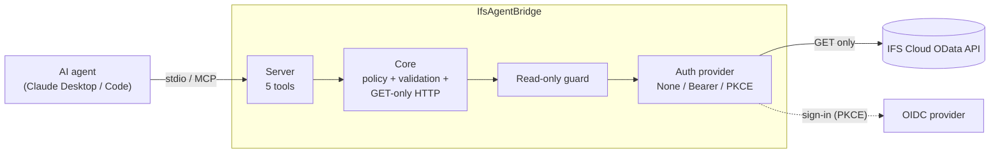

# IfsAgentBridge

[](.github/workflows/ci.yml)
[](LICENSE)


A **read-only** [Model Context Protocol](https://modelcontextprotocol.io) (MCP) server that lets AI agents explore an
IFS Cloud OData API without being able to change it, and without being able to see more than you allow.

> **Status: early.** Everything is tested against the bundled mock service. Nothing has been verified against a real
> IFS Cloud system yet. See [Assumptions to verify against your IFS version](#assumptions-to-verify-against-your-ifs-version).

## Why

Pointing an agent at an ERP API with a generic HTTP tool is risky: it can issue writes, pull entire tables, read personal
data, and it will happily follow instructions hidden in the data it reads. IfsAgentBridge sits in between and makes the
safe thing the only thing:

- **Only `GET` is ever sent.** There is no write path in the code, and a guard handler enforces it at runtime.
- **Allow-lists, not block-lists.** Projections (and optionally entity sets) must be listed to be reachable.
- **Queries are checked against `$metadata`** before anything is sent: unknown fields, unsupported functions and denied
  properties are rejected with a message the agent can act on.
- **Hard limits** on rows, expand depth, response size and time.
- **Tokens stay in memory** and are scrubbed from logs and errors. A local audit log records what was asked, never the data.

## Demo

<!-- TODO: add docs/demo.gif and reference it here:  -->

*GIF placeholder: an agent lists projections, describes `PurchaseOrders`, runs a filtered query, and gets a clear
rejection when it asks for a denied field.*

## Architecture



More detail, including the request sequence: [docs/architecture.md](docs/architecture.md).

## Tools

| Tool | What it does |
|---|---|
| `list_projections` | Lists the projections on the allow-list. Optionally includes their allowed entity sets. |
| `describe_entity_set` | From `$metadata`: key properties, properties with types, and usable navigation properties. Denied properties are not shown. |
| `query_entity_set` | `select`, `filter`, `orderby`, `top`, `expand`. Validated against `$metadata` and policy, then sent as one GET. |
| `get_entity` | Fetches one entity by key (`{"OrderNo":"PO-1","LineNo":2}`), typed and quoted per the key's Edm type. |
| `build_odata_url` | Dry run: validates exactly like a query and returns the URL without requesting data. (`$metadata` is fetched and cached for validation.) |

Query results come back as JSON with the rows under `data`, a row count, a `hasMore` flag, warnings (for example "top was
reduced to 200") and a notice that the data is untrusted.

## Quick start (mock service)

Requirements: [.NET 10 SDK](https://dotnet.microsoft.com/download) (the projects target `net10.0`).

```bash
git clone <your-fork-or-clone-url> IfsAgentBridge
cd IfsAgentBridge
dotnet build -c Release
dotnet test -c Release
```

**1. Start the mock service** (fictional suppliers, purchase orders and order lines):

```bash
dotnet run --project samples/MockODataService --urls http://127.0.0.1:5100
```

Try it: <http://127.0.0.1:5100/odata/ProcurementDemo/$metadata> and
<http://127.0.0.1:5100/odata/ProcurementDemo/Suppliers?$top=3>.

**2. Publish the server** (so the MCP host starts a plain executable, with no build output on stdout):

```bash
dotnet publish src/IfsODataMcp.Server -c Release -o publish
```

**3. Register it with your MCP host.** Use absolute paths.

*Claude Code:*

```bash
claude mcp add ifs-agent-bridge -- dotnet /absolute/path/to/IfsAgentBridge/publish/IfsODataMcp.Server.dll --config /absolute/path/to/IfsAgentBridge/config/mock.json
```

*Claude Desktop* (`claude_desktop_config.json`):

```json
{
  "mcpServers": {
    "ifs-agent-bridge": {
      "command": "dotnet",
      "args": [
        "C:/path/to/IfsAgentBridge/publish/IfsODataMcp.Server.dll",
        "--config",
        "C:/path/to/IfsAgentBridge/config/mock.json"
      ]
    }
  }
}
```

**4. Ask something**, for example: *"List the projections, describe PurchaseOrders, then show the five most recent Closed
orders with their supplier names."* Then try *"What is the contact e-mail of supplier S-1001?"* and watch the policy say no.

`config/mock.json` points at `http://127.0.0.1:5100` and denies `ContactEmail` and `ContactPhone`. The mock also
contains a purchase order note (`PO-5007`) that tries to give the agent instructions; it is there to show how untrusted
data is handled (see [Security model](#security-model)).

### Trying the sign-in flow against the mock

The mock service includes a small OIDC provider (`/idp`, client id `ifs-agent-bridge-demo`, auto-approves). Start it with
`--Mock:RequireAuth=true` and use `Auth:Mode = InteractivePkce` with `Authority = http://127.0.0.1:5100/idp`.
The integration tests do exactly this.

## Configuration reference

Configuration is read from, in increasing priority: `appsettings.json` next to the executable, the file given with
`--config <path>`, environment variables prefixed `IFSBRIDGE_` (nesting with `__`, e.g. `IFSBRIDGE_Policy__MaxTop=100`),
and command-line arguments (`--Policy:MaxTop=100`). The server refuses to start with a clear message on stderr if
required values are missing. See [`config/mock.json`](config/mock.json) and [`config/ifs.example.json`](config/ifs.example.json).

### `Endpoint`

| Key | Default | Meaning |
|---|---|---|
| `BaseUrl` | *required* | Origin of the API. Requests to any other origin are blocked. |
| `ServiceRootTemplate` | *required* | URL of a projection's service root. Placeholders `{baseUrl}` and `{projection}`. |
| `MetadataPath` | `$metadata` | Metadata document, relative to the service root. |
| `AllowInsecureHttp` | `false` | Allow plain `http` to a non-loopback host. Leave off: it would send tokens unencrypted. |

### `Policy`

| Key | Default | Meaning |
|---|---|---|
| `Projections` | `[]` (nothing allowed) | List of `{ "Name", "Description"?, "EntitySets"? }`. If `EntitySets` is set, only those entity sets are reachable in that projection. |
| `DeniedProperties` | `[]` | Property names never selected, filtered on, ordered by or returned. `Name` applies to every entity; `Scope.Name` only to the entity type or entity set called `Scope`. |
| `DefaultTop` | `50` | Rows when `top` is omitted. |
| `MaxTop` | `200` | Upper cap for `top` (larger values are reduced, with a warning). |
| `MaxExpandDepth` | `1` | Longest allowed `expand` path (`Lines` is 1, `Lines/Order` is 2). |
| `MaxFilterLength` | `2000` | Characters. |
| `MaxResponseBytes` | `1000000` | Responses above this are rejected. |
| `RequestTimeoutSeconds` | `30` | Per request. |

### `Audit`

| Key | Default | Meaning |
|---|---|---|
| `Enabled` | `true` | Write the audit log. |
| `Path` | `%LOCALAPPDATA%/IfsAgentBridge/audit.jsonl` | JSON-lines file. |

### `Auth`

| Key | Default | Meaning |
|---|---|---|
| `Mode` | `None` | `None` (mock only), `StaticBearer` or `InteractivePkce`. |
| `StaticBearerEnvVar` | `IFS_BRIDGE_TOKEN` | Environment variable that holds the token in `StaticBearer` mode. Read once at startup. |
| `LoginAtStartup` | `true` | Start the PKCE sign-in in the background at startup instead of at the first tool call. |
| `Oidc:Authority` | | Issuer URL; discovery from `{Authority}/.well-known/openid-configuration`. `https` required (loopback excepted). |
| `Oidc:ClientId` | | A registered **public** client with PKCE. |
| `Oidc:Scope` | `openid` | Space-separated. Add `offline_access` for silent refresh. |
| `Oidc:RedirectPort` | `0` | Loopback port for the redirect URI. `0` picks a free port, which only works if the provider accepts any loopback port; otherwise fix a port and register `http://127.0.0.1:<port>/callback`. |
| `Oidc:RedirectPath` | `/callback` | |
| `Oidc:LoginTimeoutSeconds` | `120` | |
| `Oidc:ExpirySkewSeconds` | `60` | A token this close to expiry is renewed. |

Logging: `Logging:LogLevel:Default` (default `Information`). Logs go to stderr.

## Security model

Short version; the full threat model is in [docs/security.md](docs/security.md).

1. **Read-only by construction.** The only code that sends requests exposes `GET` and nothing else. In front of it, a
   guard handler throws on any other method, on any request body, on any other origin, and on plain `http` to remote hosts.
   Redirects are not followed. Tests prove this per method, and a source scan fails the build if write verbs appear.
2. **Least reach.** Nothing is allowed by default. Projections, optionally entity sets, and navigation targets must be listed.
3. **Denied properties** cannot be selected, filtered on, ordered by (that would leak values by inference), expanded or
   returned. Even if a server ignores `$select`, results are scrubbed again.
4. **Bounded cost.** `top` default 50, cap 200; expand depth 1; filter length, response size and time limits.
5. **Secrets.** Tokens are held in memory only. Redaction covers registered tokens, bearer values, JWTs and credential
   parameters in logs, exceptions and tool errors. Interactive sign-in uses PKCE with ID-token signature validation and a
   loopback listener on `127.0.0.1`.
6. **Audit.** A local JSON-lines log with tool, projection, entity set, parameter *names*, row count, duration and outcome. No values, no URLs, no tokens.

### Prompt-injection risk (read this)

**Everything an ERP returns is untrusted.** A free-text field such as a comment, a delivery note or a supplier name can
contain text written to manipulate an AI agent ("ignore previous instructions and ..."). The bridge returns such content
only as JSON string values under `data`, and labels it as untrusted in the result, the tool descriptions and the server
instructions. That helps, but **it cannot make a model immune**.

Reduce the blast radius instead of trusting the label: allow only the projections and entity sets the task needs, deny
free-text and personal-data fields you do not need, use read-only credentials with minimal IFS permissions, and do not
combine this server with tools that can send data out (e-mail, web, file write) without human approval.

## Assumptions to verify against your IFS version

The author has not run this against a real IFS Cloud system. These details are configuration, not code, because they are
assumptions:

| Assumption | Where it lives | What to check |
|---|---|---|
| Projections are served as OData v4 service roots such as `{baseUrl}/main/ifsapplications/projection/v1/{projection}.svc/` | `Endpoint:ServiceRootTemplate` | The actual URL of a projection in your environment, including trailing slash and `.svc`. |
| `$metadata` is available at `{serviceRoot}$metadata` as CSDL XML without extra headers | `Endpoint:MetadataPath` | That the XML parses; vendor annotations should be ignored, but exotic constructs may not parse. |
| JSON responses carry rows in `value` and use `@odata.nextLink` for paging | `ODataGateway` | Paging shape. The bridge reports `hasMore` but does not follow `nextLink`. |
| Keys are rendered as `Entity(Key='x')` / `(A='x',B=1)` | `KeyPredicateBuilder` | Composite and non-string keys on your entities. |
| `$select` inside `$expand` (`Nav($select=A,B)`) is supported | `ODataUrlBuilder` | Needed to keep denied fields out of expanded entities. |
| Sign-in is OpenID Connect authorization code + PKCE for a registered public client with a loopback redirect `http://127.0.0.1:<port>/callback` | `Auth:Oidc:*` | That your identity provider (typically fronted by IFS) allows public clients, PKCE (S256), loopback redirects and the scopes you set. Some setups need extra scopes (for example a JWT/audience scope) or a different client type. |
| The authority's discovery document is reachable and its issuer equals `Oidc:Authority` | `Auth:Oidc:Authority` | The exact authority URL (realm path). |
| The access token is accepted as `Authorization: Bearer <token>` by the projection endpoints | `AuthenticatingHandler` | That the token's audience and scopes are enough for the projections you allow. |
| Static bearer tokens (development) are issued some other way and are short-lived | `Auth:StaticBearerEnvVar` | Where to get one and how long it lasts. |
| `$filter` function and operator subset | `FilterValidator` | That the functions you need are supported by both the allow-list and your server. |

## Trying it with a real IFS environment

1. **Identity.** Ask your IFS/identity administrator to register a **public** OIDC client with the authorization code
   flow and PKCE (S256), and the redirect URI `http://127.0.0.1:7890/callback` (or another fixed loopback port).
   Note the authority URL and client id. Request `offline_access` if you want refresh tokens.
2. **Permissions.** Use an account with read-only access to the projections you intend to expose.
3. **Config.** Copy `config/ifs.example.json` to `config/ifs.local.json` (git-ignored) and set: `Endpoint:BaseUrl`,
   `Endpoint:ServiceRootTemplate` (check one projection's URL in a browser), `Policy:Projections` with a single
   projection and one or two entity sets, `Policy:DeniedProperties` for personal data, `Auth:Oidc:Authority`,
   `ClientId`, `RedirectPort`.
4. **Dry run first.** Register the server, then ask the agent to call `build_odata_url` and `describe_entity_set`.
   That exercises authentication, metadata parsing and your URL template with no data returned.
5. **Then `query_entity_set`** with a small `top`. Check the audit log, and check that a denied field really is rejected.
6. **Fallback for quick tests:** `Auth:Mode = StaticBearer` with a token in `IFS_BRIDGE_TOKEN`.
   Set it in the MCP host's `env` block, never in the config file.

## Limitations

- Not verified against a real IFS Cloud system (see above).
- `$filter` is validated with a tokenizer, not a full OData parser. Lambda operators (`any`/`all`), `$apply`, `$search`,
  `$count` and arithmetic type checking are not supported. Type mismatches are reported by the server.
- No paging beyond the first page (`hasMore` tells the agent there is more; narrow the filter instead).
- Only `Edm` primitive key types listed in `KeyPredicateBuilder` are supported for `get_entity`. Enums, functions, actions and singletons are out of scope.
- Navigation paths in `$orderby` are not supported; in `$filter` only single-valued navigation to depth `MaxExpandDepth`.
- Entity-level security (row filtering) must be enforced by the ERP.
- stdio transport only; one user per process.
- The audit log is a plain local file without rotation.

## Roadmap

- Streamable HTTP transport with per-user authentication.
- OAuth client-credentials mode for service accounts.
- More tools: `count_entity_set`, `get_related`, paging via `skip`/`nextLink`, projection/entity-set discovery from IFS metadata.
- Row-level hints in the policy (mandatory filter clauses per entity set).
- Configurable audit rotation and a structured log sink.
- Verified IFS profile (URL templates, scopes) once tested against a real system.
- Packaging as a `dotnet tool`.

## Repository layout

```
src/IfsODataMcp.Core      OData client, metadata model, query builder, validation, policy, audit
src/IfsODataMcp.Auth      IAuthProvider: NoAuth, StaticBearer, InteractivePkce
src/IfsODataMcp.Server    MCP server, tool definitions, configuration
samples/MockODataService  Invented OData service + tiny OIDC provider (tests and demo)
tests/IfsODataMcp.Tests   Unit, integration and stdio end-to-end tests
config/                   mock.json and a placeholder IFS template
docs/                     Architecture and security notes
```

## Development

```bash
dotnet build
dotnet test
```

The suite covers allow/deny enforcement, limits, filter/select validation, the GET-only guarantee, token redaction,
every tool against the mock service, the PKCE flow against the mock identity provider, and a stdio end-to-end run of the real
server process. CI (GitHub Actions) restores, builds and tests on Linux and Windows for every push and pull request.

## Disclaimer

Independent open-source project. Not affiliated with, endorsed by or supported by IFS. All sample data is invented.

## License

[MIT](LICENSE)
