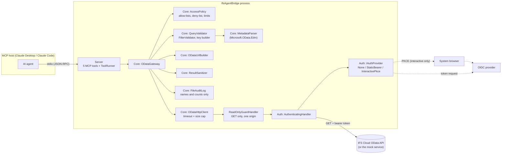
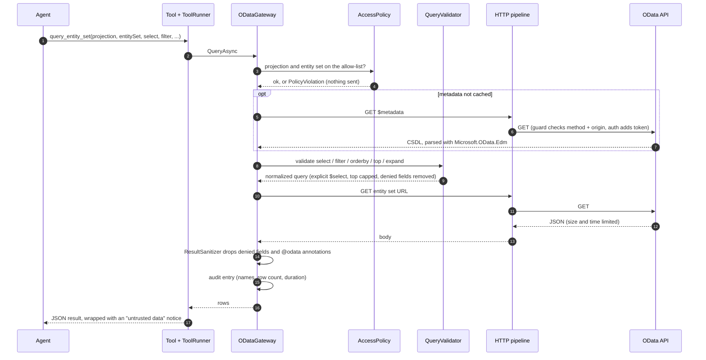

# Architecture

IfsAgentBridge is a stdio MCP server. An MCP client (Claude Desktop, Claude Code, any other host) starts it as a child
process and calls five tools. The server turns each call into at most one validated HTTP `GET` against the configured
OData API.

## Components

| Project | Responsibility |
|---|---|
| `IfsODataMcp.Core` | Everything that decides what may be asked and how: policy, `$metadata` model, query validation, URL building, the GET-only HTTP pipeline, result sanitizing, audit log, secret redaction. No dependency on MCP or on a specific identity provider. |
| `IfsODataMcp.Auth` | `IAuthProvider` and its three implementations, the handler that adds the `Authorization` header, and the loopback browser used by the PKCE flow. |
| `IfsODataMcp.Server` | Host, configuration loading, DI wiring and the MCP tool definitions. Tools hold no logic of their own. |
| `samples/MockODataService` | Invented OData service (suppliers, purchase orders, order lines, staff) and a small OIDC provider. Used by the tests and the demo. |
| `tests/IfsODataMcp.Tests` | Unit tests, integration tests against the mock service, and a stdio end-to-end test that talks to the real server process through the MCP client. |

## One `query_entity_set` call

## Request pipeline

Outermost handler first:

1. **`ReadOnlyGuardHandler`** rejects any method other than `GET`, any request with a body, any host/port/scheme that
   differs from `Endpoint:BaseUrl`, and plain `http` to a non-loopback host.
2. **`AuthenticatingHandler`** adds `Authorization: Bearer ...` and tells the provider to drop the token on a `401`.
3. **`SocketsHttpHandler`** with redirects and cookies disabled.

Because the guard is outermost, a bug elsewhere cannot make a write request reach the authentication handler or the
network.

## Design decisions

- **Validation without a full OData parser.** `$filter` is tokenized and every identifier is resolved against the entity
  type and the deny-list; operators, functions and literals come from fixed allow-lists. Anything unrecognized is
  rejected. This keeps the attack surface small and the error messages specific. `$filter` lambda operators
  (`any`/`all`) are not supported.
- **Explicit `$select` everywhere.** Even when the caller omits `select`, the URL lists the permitted properties, and
  expanded entities get a nested `$select`. Denied fields are therefore never requested, not just filtered afterwards.
- **Sanitizing as a second layer.** The result is scrubbed again in case a server ignores `$select`.
- **Metadata is cached per projection** for the process lifetime; failures are not cached.
- **stdout belongs to the protocol.** All logging goes to stderr.
